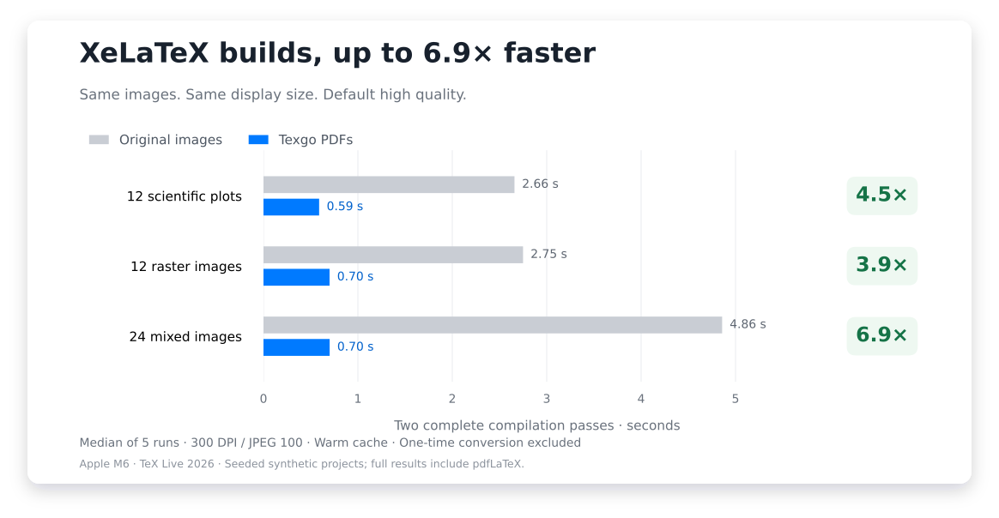
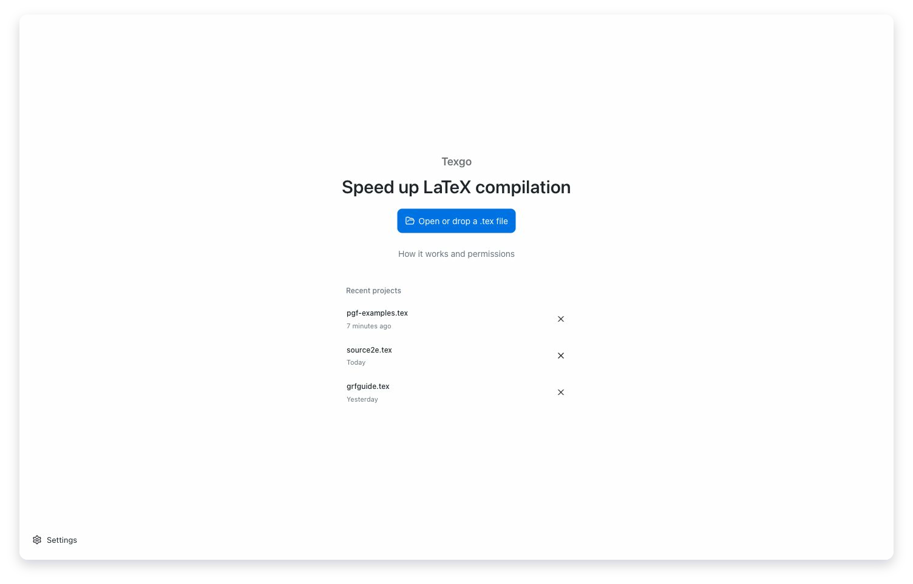
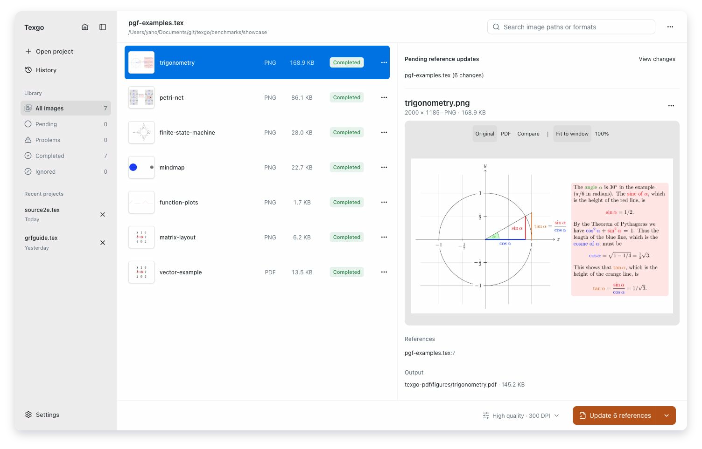
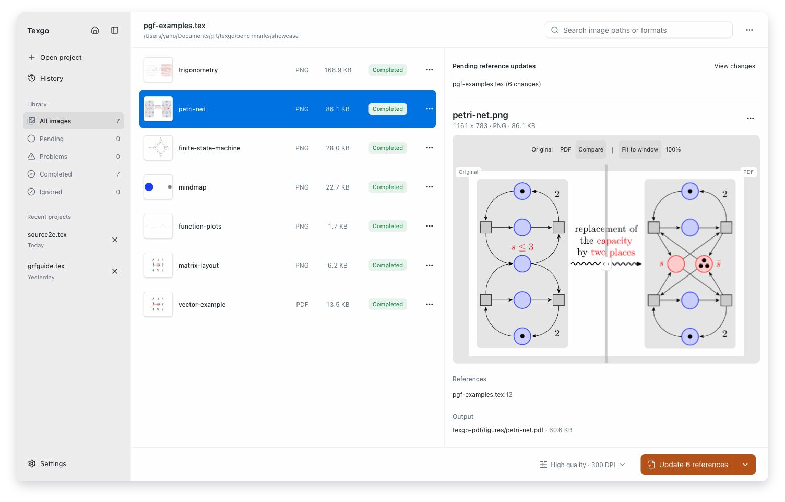

# Texgo

[中文](README.zh.md)

**Write more. Wait less.**

Don't let another compile break your train of thought. Texgo prepares project images
as PDFs, keeps them up to date, and asks before changing your `.tex` references.
**XeLaTeX builds were up to 6.9× faster in our benchmarks.**

Available for Windows, macOS and Linux. Projects stay on your computer.

[Download](https://github.com/yaho7/texgo/releases/latest) ·
[User guide](desktop/README.md) · [Troubleshooting](docs/troubleshooting.md)

## Get back to writing sooner

The same 24-image project went from **4.86 seconds to 0.70 seconds** for two complete
XeLaTeX passes. That's **85.6% less waiting**, after the one-time image conversion.

Measured on an Apple M6 with TeX Live 2026, default high quality, and fixed-seed
synthetic projects. Median of five warm runs; each sample includes two full passes.
[Full results and methodology](docs/benchmarks/README.md) include conversion cost,
PDF sizes, pdfLaTeX comparisons and official-document controls.

## Open, convert, update references

1. Open or drop the main `.tex` file. Texgo scans its included files and images.
2. Convert images; compare the original with the resulting PDF. Reconvert after changing quality.
3. The workspace lists affected files. Click Update references, then confirm or cancel in the dialog.

Background monitoring refreshes status. Smart Convert can update Texgo-managed
PDFs, but neither feature edits `.tex` files automatically. Before applying a
reference update, the final confirmation silently rescans saved files and rebuilds
reference locations. Texgo verifies complete file fingerprints before writing; a
further edit stops the write. Save unsaved changes in other editors before applying;
Desktop cannot inspect their in-memory buffers.

Operation history provides guarded Undo. Image menus offer rename, retry, temporary
or permanent ignore, and explicit reconversion. Settings include Chinese/English,
processing defaults, background behavior, notifications and global shortcuts.

### Home

### Workspace

### Compare

Screenshots use the production frontend with examples from the official PGF/TikZ
manual and simulated native services. [Artwork sources](docs/images/README.md).

## Desktop and automation

One installer includes the desktop app and the independent `texgo-engine` CLI/JSON-RPC
engine. Image processing needs neither TeX nor GraphicsMagick. Existing engine
compilation commands require a local TeX distribution and `latexmk`.

- [CLI and API](docs/api.md), [configuration schema](docs/project.schema.json),
  [VS Code / LaTeX Workshop configuration example](examples/vscode/)
- [Platform requirements, installed engine paths and signed updates](docs/desktop-release.md)
- [Development](docs/development.md), [contributing](CONTRIBUTING.md),
  [architecture and delivery status](docs/product-upgrade-report.md)

Built with Tauri 2, Rust, React and Tailwind CSS. Ordinary pushes run lightweight checks; manual builds produce artifacts.
Only an exact `v<manifest version>` tag can publish a release after all four platform
builds pass. Windows installers are unsigned; macOS signing and notarization results
must be checked in the release workflow.

## Contributors

- [yaho7](https://github.com/yaho7)
- [OpenAI](https://github.com/openai)

[MIT license](LICENSE).
