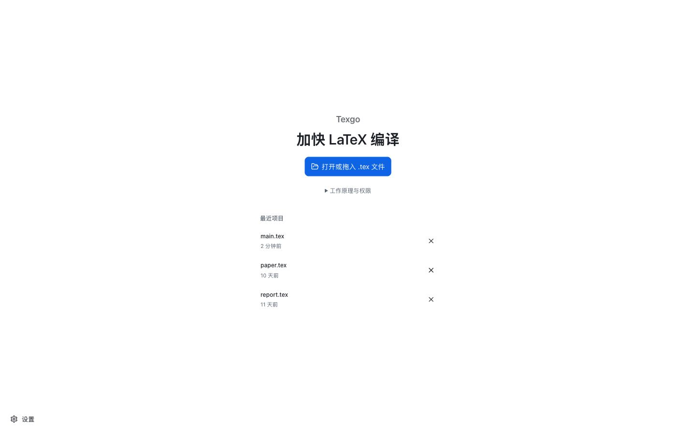
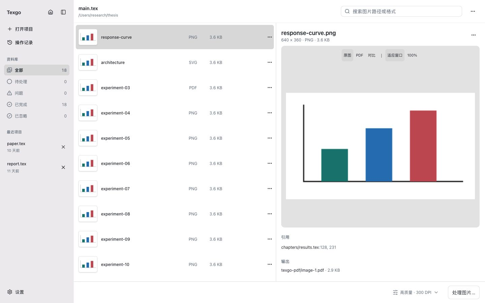
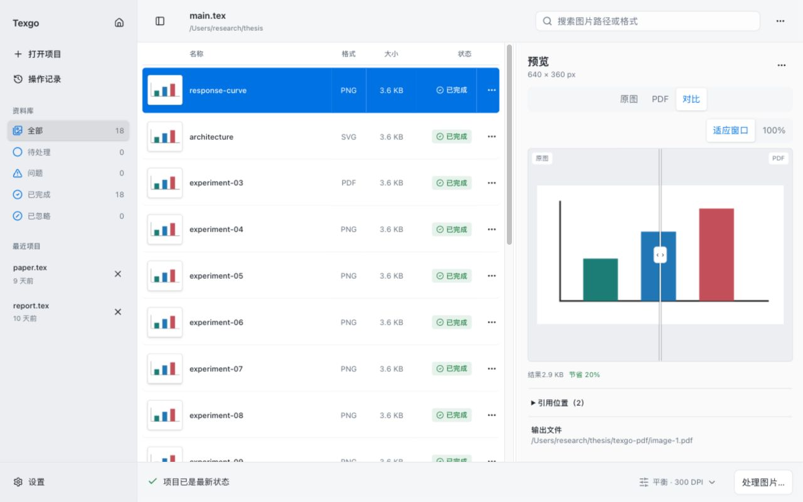

# Texgo

[English](README.md)

**加快 LaTeX 编译。** Texgo 将项目图片预处理为 PDF，持续更新图片，并让你在修改 `.tex` 引用前审核变更。支持 Windows、macOS 和 Linux，项目文件保留在本机。

[下载](https://github.com/yaho7/texgo/releases/latest) · [使用说明](desktop/README.zh.md) · [常见问题](docs/troubleshooting.md)

## 打开、处理、审核

1. 打开或拖入 `.tex` 主文件，扫描子文件和图片。
2. 处理待更新图片，对比原图与生成的 PDF。
3. 检查引用变更，选择后明确点击应用。

后台检测只刷新状态；Smart Convert 可以更新 Texgo 管理的 PDF，两者都不会自动修改 `.tex`。应用引用变更前，Texgo 会重新读取目标文件并核对完整 fingerprint；文件变化则停止写入，要求重新扫描。应用前请先保存其他编辑器的未保存内容，桌面版无法检测外部编辑器内存中的修改。

操作记录支持安全撤销。图片菜单提供重命名、重试、临时或永久忽略，以及手动重新处理。设置支持中英文切换、处理默认值、后台行为、通知和全局快捷键。

### 首页

### 工作区

### 对比

截图来自正式前端，使用固定示例数据与模拟原生接口。网页预览会打开示例项目，安装后的桌面应用会弹出系统文件选择器。截图用于说明界面，不代表已完成各平台安装验收。

## 桌面应用与自动化

一个安装包包含图形界面和独立的 `texgo-engine` CLI/JSON-RPC 引擎。图片处理不依赖 TeX 或 GraphicsMagick；现有引擎编译命令需要本机 TeX 发行版与 `latexmk`。

- [CLI 与 API](docs/api.md)、[配置定义](docs/project.schema.json)、[VS Code / LaTeX Workshop 配置示例](examples/vscode/)
- [平台要求、引擎安装路径与签名更新](docs/desktop-release.md)
- [开发](docs/development.md)、[贡献指南](CONTRIBUTING.md)、[架构与交付状态](docs/product-upgrade-report.md)

使用 Tauri 2、Rust、React 与 Tailwind CSS。普通推送只做轻量检查，手动构建生成产物；只有与项目版本完全一致的 `v版本号` 标签，在四个平台构建通过后才能发布。Windows 安装包未签名；macOS 签名与公证结果以实际发布工作流为准。

## 贡献者

- [yaho7](https://github.com/yaho7)
- Codex

[MIT 许可证](LICENSE)。
