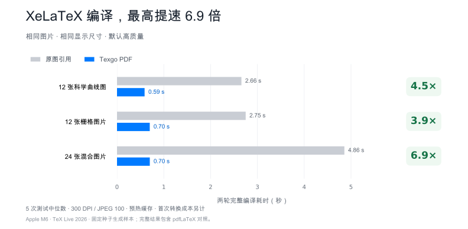
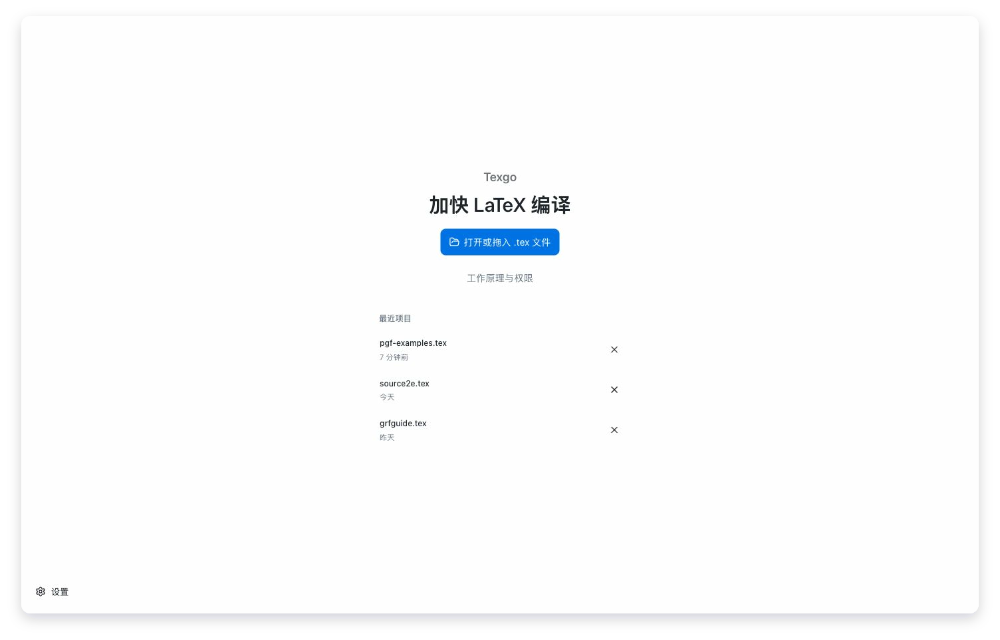
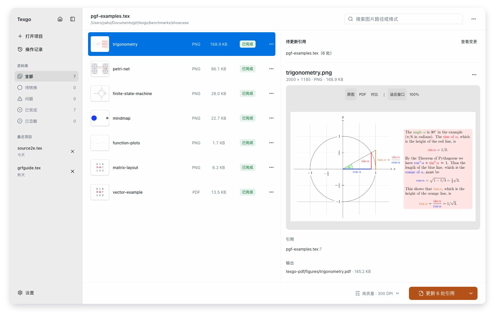
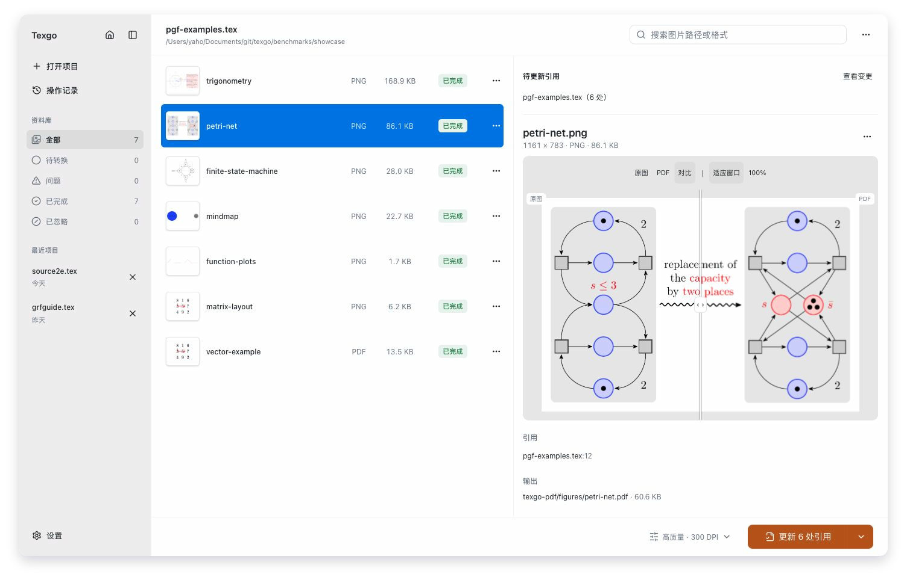

# Texgo

[English](README.md)

**少等编译，多写论文。**

别让反复编译打断思路。Texgo 提前将图片转换为 PDF，持续更新图片，并由你确认 `.tex` 引用修改。**XeLaTeX 实测最高提速 6.9 倍。**

支持 Windows、macOS 和 Linux，项目文件保留在本机。

[下载](https://github.com/yaho7/texgo/releases/latest) · [使用说明](desktop/README.zh.md) · [常见问题](docs/troubleshooting.md)

## 把等待的时间，还给写作

同一份 24 张图片的项目，两轮 XeLaTeX 完整编译从 **4.86 秒缩短到 0.70 秒**。首次图片转换后，每次重复编译**少等 85.6%**。

Apple M6、TeX Live 2026、默认高质量参数，固定种子生成的合成项目。预热后测试五次取中位数，每次包含两轮完整编译。[完整结果与测试方法](docs/benchmarks/README.zh.md)包含首次转换成本、PDF 体积、pdfLaTeX 对照和官方文档基线。

## 打开、转换、更新引用

1. 打开或拖入 `.tex` 主文件，扫描子文件和图片。
2. 转换图片，对比原图与生成的 PDF；修改质量后可以重新转换。
3. 页面会列出待修改文件，点击“更新引用”，在弹窗中确认或取消。

后台检测只刷新状态；Smart Convert 可以更新 Texgo 管理的 PDF，两者都不会自动修改 `.tex`。点击最终确认时，Texgo 会自动重新扫描已保存文件、定位最新引用，并在写入前核对完整 fingerprint；文件随后再次变化则停止写入。应用前请先保存其他编辑器的未保存内容，桌面版无法检测外部编辑器内存中的修改。

操作记录支持安全撤销。图片菜单提供重命名、重试、临时或永久忽略，以及手动重新转换。设置支持中英文切换、转换默认值、后台行为、通知和全局快捷键。

### 首页

### 工作区

### 对比

截图使用正式前端、PGF/TikZ 官方手册示例和模拟原生接口。[图片来源](docs/images/README.md)。

## 桌面应用与自动化

一个安装包包含图形界面和独立的 `texgo-engine` CLI/JSON-RPC 引擎。图片处理不依赖 TeX 或 GraphicsMagick；现有引擎编译命令需要本机 TeX 发行版与 `latexmk`。

- [CLI 与 API](docs/api.md)、[配置定义](docs/project.schema.json)、[VS Code / LaTeX Workshop 配置示例](examples/vscode/)
- [平台要求、引擎安装路径与应用更新](docs/desktop-release.md)
- [开发](docs/development.md)、[贡献指南](CONTRIBUTING.md)、[架构与交付状态](docs/product-upgrade-report.md)

使用 Tauri 2、Rust、React 与 Tailwind CSS。普通推送只做轻量检查，手动构建生成产物；只有与项目版本完全一致的 `v版本号` 标签，在四个平台构建通过后才能发布。Windows 安装包未签名；macOS 签名与公证结果以实际发布工作流为准。

## 贡献者

- [yaho7](https://github.com/yaho7)
- [OpenAI](https://github.com/openai)

[MIT 许可证](LICENSE)。
